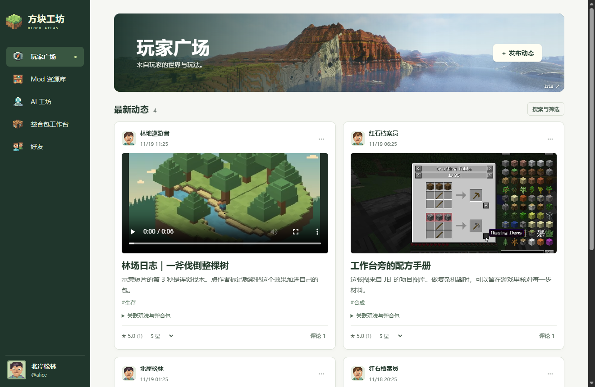
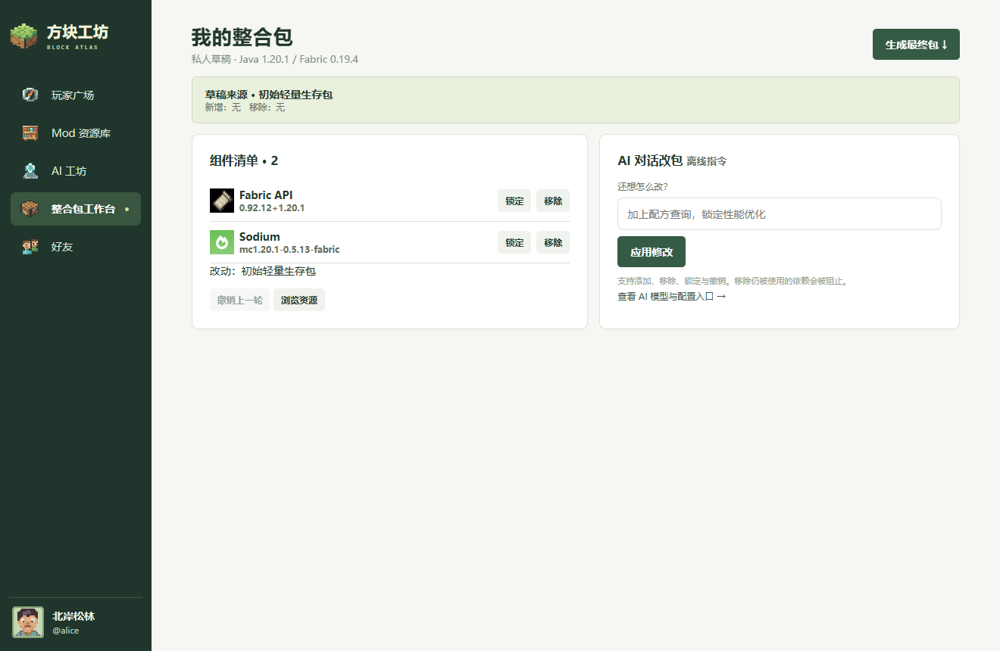
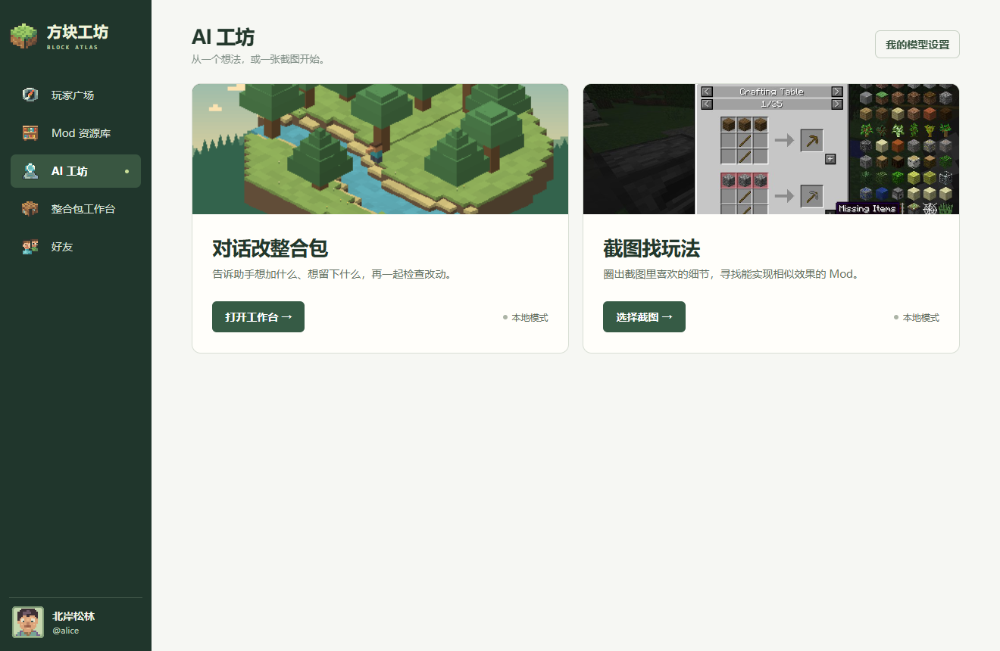

<div align="center">

# 🧱 方块工坊 · Block Atlas

**面向 Minecraft（Java 1.20.1 / Fabric）的跨平台玩法社区、整合包工作台与 AI 改包工坊**

*从一篇实机分享帖出发，把喜欢的玩法直接带进你的 `.mrpack` 整合包*

<p>
  <a href="https://github.com/cAurorax/BlockAtlas/releases/latest">
    
  </a>
  
  
  
  
</p>

<p>
  <a href="#-项目简介">项目简介</a> •
  <a href="#-界面预览">界面预览</a> •
  <a href="#-核心特性">核心特性</a> •
  <a href="#-快速开始">快速开始</a> •
  <a href="#-3-分钟完整体验路线">体验路线</a> •
  <a href="#-ai-模型配置">AI 配置</a> •
  <a href="#-技术架构与目录结构">技术架构</a> •
  <a href="#-测试验证与说明">测试与说明</a>
</p>

<br />



</div>

---

## 📖 项目简介

**方块工坊（Block Atlas）** 是一款本地优先（Local-First）的 Minecraft 玩家社区与整合包构建应用，致力于打通「**看到喜欢的玩法 → 搞清对应 Mod → 派生修改整合包 → 导出使用 → 反馈实测结果**」的完整链路。

当你刷到一条“一斧伐倒整棵树”的分享帖时，可以直接点击作者标注的视频时间点提取对应 Mod，或一键派生作者当时发布的整份整合包版本，在自己的草稿中通过自然语言指令或截图检索继续调整，最后生成标准 Modrinth `.mrpack` 文件与跨端取包码。


- **Windows 用户**：可直接前往 [Releases](https://github.com/cAurorax/BlockAtlas/releases/latest) 下载绿色免安装桌面版（`BlockAtlas-v1.0.0-win64.zip`），无需安装 Python 或 Minecraft，双击即用。
- **macOS / Linux / 开发者**：克隆本仓库源码，4 行命令即可在本地启动完整 Web 玩家端与管理后台；仓库同时包含原生微信小程序工程与 Windows WebView2 桌面壳源码。

---

## 🖼️ 界面预览

<table>
  <tr>
    <td align="center" width="50%">
      
      <br />
      <sub><b>登录页</b> · 分屏视觉入口与内置演示账号折叠面板</sub>
    </td>
    <td align="center" width="50%">
      
      <br />
      <sub><b>Mod 资源库</b> · 版本锁定清单、收藏筛选与 Modrinth 一键导入</sub>
    </td>
  </tr>
  <tr>
    <td align="center" width="50%">
      
      <br />
      <sub><b>整合包工作台</b> · 草稿来源对比、锁定/撤销保护与 AI 对话改包</sub>
    </td>
    <td align="center" width="50%">
      
      <br />
      <sub><b>AI 工坊</b> · 对话改整合包与截图找玩法双入口及模式状态</sub>
    </td>
  </tr>
  <tr>
    <td align="center" width="50%">
      
      <br />
      <sub><b>截图找玩法</b> · 框选截图局部区域检索相似效果 Mod</sub>
    </td>
    <td align="center" width="50%">
      
      <br />
      <sub><b>个人模型设置</b> · 独立覆盖文本/视觉通道，密钥 DPAPI 加密不回显</sub>
    </td>
  </tr>
  <tr>
    <td align="center" width="50%">
      
      <br />
      <sub><b>独立运营后台</b> · 活跃指标、七日增长柱状图与举报审核入口</sub>
    </td>
    <td align="center" width="50%">
      
      <br />
      <sub><b>社区 AI 配置</b> · 管理员统一管理社区默认与审核辅助模型</sub>
    </td>
  </tr>
</table>

<details>
<summary>📱 展开查看移动端 / 窄屏响应式布局（左侧像素物品栏导航）</summary>
<p align="center">
  <br />
  
</p>
</details>

---

## ✨ 核心特性

### 1. 玩家广场与时间点玩法联动
- 支持发布文字、图片（JPG / PNG / WebP / GIF）与 MP4 视频动态，按关键词、标签与日期（北京时间）组合检索。
- 帖子支持设置 **公开 / 好友可见 / 仅自己可见** 三级权限，并支持 1–5 星评分、嵌套评论回复、敏感词过滤与举报。
- **玩法与整包绑定**：作者可为帖子关联 Mod 与视频秒数标记（点击即可跳至对应片段并加入草稿），也可在发帖时冻结当前草稿生成**不可变整包版本**。
- **社交与玩家行囊**：点击作者头像/昵称直达玩家主页，发起或处理好友申请；左下角像素头像唤出「玩家行囊」快速管理我的发布、账号设置与登出。

### 2. 整包版本派生（Fork）与实测墙
- 每次随帖发布的整合包都会生成带 SHA-256 摘要的不可变版本快照（无改动不产生重复版本）。
- 任意玩家可查看历史版本清单并点击 **「基于这一版修改」** 派生到个人草稿，实时展示增删差异，完全不影响原帖。
- 每个整包版本拥有独立的实测记录墙（**成功 / 异常 / 未启动**），支持关联自己的公开媒体帖作为实测证据，旧版反馈不混入新版。

### 3. 版本锁定的 Mod 资源库
- 面向 **Minecraft Java 1.20.1 / Fabric**，内置 5 款真实 Modrinth 热门资源并固定版本与 SHA-1 / SHA-512 校验信息。
- 支持粘贴 **Modrinth 项目链接或 slug**（如 `lithium`），实时拉取公共索引预览后导入，自动检查必需前置依赖与冲突声明，不下载也不执行任意 JAR。
- 支持 Mod 收藏、收藏筛选以及按具体版本记录个人实测笔记。

### 4. AI 工坊（离线可用 + 在线模型双模式）
- **对话改整合包**：支持添加、移除、锁定、解锁与多步撤销（最多保留 30 步历史）；自动补齐必需依赖，拦截删除已锁定组件或被其他 Mod 依赖的基础组件，并具备跨端草稿并发冲突检测。
- **截图找玩法**：上传 JPG / PNG / WebP 截图并自由框选局部区域，结合可选描述从资源库中检索可能实现相似效果的候选 Mod 与理由（原始截图不落库）。
- **无 Key 也能演示**：默认本地模式采用中文指令解析与本地参考图库颜色/布局比对；配置在线大模型后无缝切换至在线推理。

### 5. `.mrpack` 快照导出与跨端取包
- 一键生成包含标准 `modrinth.index.json` 的 `.mrpack` 整合包文件，锁定导出瞬间的版本、文件哈希与 Modrinth CDN 下载地址，后续继续修改草稿不影响已导出快照。
- 同步生成 **24 小时有效取包码**，可在手机/小程序配包、在电脑端 `/pickup` 页面输入取包码直接下载。

### 6. 独立 Web 运营后台
- 提供完全独立的 `/admin` 后台界面与管理员会话，覆盖运营统计概览、举报审核闭环、帖子下架/恢复、用户停用/删除、资源说明维护、敏感词库、AI 社区模型设置与完整操作审计日志。
- 举报审核支持主动生成 **AI 辅助证据摘要**（离线时自动降级为本地证据整理），辅助审核员核对原帖并人工作出保留或下架决定。

### 7. 启动游戏（游戏本体安装 + 启动配置）
- **一键安装游戏本体**：没有 Minecraft 的机器点一次按钮即可装好 1.20.1 + Fabric 0.19.4 与 Mojang Java 运行时，后台任务 + 阶段进度，装完直接可启动。
- **启动配置**：内存支持自动（按 Mod 数量与本机内存估算）与手写两种模式；可设启动窗口宽高；自动扫描本机 Java 运行时并列表选择。
- **启动与停止**：同一按钮按状态切换，实时显示 PID；日志面板按字节游标增量追加，不整块重绘。
- 详见 [docs/GAME_LAUNCH.md](docs/GAME_LAUNCH.md)。

---

## 🚀 快速开始

### 方式一：Windows 绿色免安装桌面版（推荐）
1. 前往 [Releases](https://github.com/cAurorax/BlockAtlas/releases/latest) 下载 `BlockAtlas-v1.0.0-win64.zip`。
2. 完整解压后双击 **`方块工坊.exe`** 即可打开桌面客户端（内置本地服务，监听 `127.0.0.1:18283`，无需安装 Python 或 Minecraft）。
3. 桌面发行版业务数据存放于 `%LOCALAPPDATA%\BlockAtlas\StudioRelease\data`。

### 方式二：macOS / Linux / Windows 源码运行（推荐跨平台与开发者）

需要 **Python 3.10+**（推荐 3.12）：

```bash
git clone https://github.com/cAurorax/BlockAtlas.git
cd BlockAtlas

# 创建虚拟环境并安装依赖
python3 -m venv .venv
source .venv/bin/activate          # Windows PowerShell: .venv\Scripts\Activate.ps1
pip install -r requirements.txt

# 初始化演示数据并启动服务（已有用户时不会覆盖数据）
python -m atlas.seed
python -m uvicorn atlas.server:app --host 127.0.0.1 --port 18182
```

> Windows 源码用户也可直接双击 [`atlas/start.cmd`](atlas/start.cmd) 一键创建环境并启动。

启动后在浏览器访问：

| 入口 | 源码运行地址（端口 `18182`） | Windows 发行版地址（端口 `18283`） | 用途 |
| --- | --- | --- | --- |
| **玩家社区** | `http://127.0.0.1:18182/` | `http://127.0.0.1:18283/` | 玩家广场、Mod 资源库、AI 工坊、整合包工作台 |
| **Web 管理后台** | `http://127.0.0.1:18182/admin` | `http://127.0.0.1:18283/admin` | 独立管理员登录，审核举报、用户/帖子与 AI 设置 |
| **电脑取包页** | `http://127.0.0.1:18182/pickup` | `http://127.0.0.1:18283/pickup` | 输入 24 小时取包码下载 `.mrpack` |

### 方式三：原生微信小程序（可选）
- 在微信开发者工具中导入 `atlas/miniprogram/`（含 12 个原生页面，默认连接 `http://127.0.0.1:18182`）。
- 本地调试请在开发者工具开启「不校验合法域名」；真机调试需将 `atlas/miniprogram/app.js` 中的 `baseUrl` 改为局域网/公网可达地址。

### 内置演示账号

| 角色 | 昵称 | 用户名 | 初始密码 |
| --- | --- | --- | --- |
| 玩家 | 北岸松林 | `alice` | `Alice123!` |
| 玩家 | 林地巡游者 | `bob` | `Bob12345!` |
| 玩家 | 红石档案员 | `carol` | `Carol123!` |
| 管理员 | 工坊管理员 | `admin` | `Admin123!` |

---

## 🎯 3 分钟完整体验路线

1. **看玩法与时间点标记**：用 `alice` 登录，打开《林场日志｜一斧伐倒整棵树》，展开 **「关联玩法与整合包」**，点击作者标记跳至视频第 3 秒。
2. **从作者版本派生整合包**：点击 **「查看整包与实测 → 基于这一版修改」**，在工作台查看草稿来源与差异，后续增删不影响原帖。
3. **对话改包与规则保护**：输入 `加上配方查询，锁定性能优化`，观察 `JEI` 自动加入、`Sodium` 被锁定；再输入 `移除性能优化` 或 `移除基础依赖` 触发保护提示，点击 **「撤销」** 回退。
4. **截图找玩法 & Modrinth 导入**：在「AI 工坊 → 截图找玩法」框选样图检索候选 Mod；在「Mod 资源库」输入 `lithium` 预览 1.20.1 / Fabric 正式版并确认入库。
5. **导出 `.mrpack` 与取包码**：在工作台点击 **「生成最终包」** 下载 `.mrpack`，或复制取包码到 `/pickup` 页面下载。
6. **独立后台审核闭环**：打开 `/admin` 使用 `admin` 登录，查看运营统计、用户/帖子管理及举报证据摘要审核流程。

---

## 📚 内置 Mod 资源目录

预置目录对应 **Minecraft Java 1.20.1** 与 **Fabric Loader 0.19.4**，支持通过 Modrinth 在线扩充：

| Slug | Mod 名称 | 锁定版本 | 必需依赖 | 核心作用 |
| --- | --- | --- | --- | --- |
| `fabric-api` | Fabric API | `0.92.12+1.20.1` | — | Fabric 生态通用前置与基础钩子库 |
| `sodium` | Sodium | `mc1.20.1-0.5.13-fabric` | — | 高性能渲染引擎，大幅提升帧率、减少卡顿 |
| `jei` | Just Enough Items (JEI) | `15.56.0.205` | `fabric-api` | 物品清单与合成配方查询 |
| `fallingtree` | FallingTree | `1.20.1-4.3.6` | `fabric-api` | 砍伐一格木头即可连锁伐倒整棵树 |
| `appleskin` | AppleSkin | `2.5.2+mc1.20.1` | `fabric-api` | 饥饿值、饱食度与食物恢复量 HUD 增强 |

---

## 🤖 AI 模型配置

**无需任何 API Key 即可完整体验本地模式。** 如需启用在线大模型推理：

### 支持的服务商与两级配置
- **内置预设服务商**：DeepSeek（`api.deepseek.com`）、阿里云百炼 DashScope（`dashscope.aliyuncs.com`）、OpenAI（`api.openai.com`）及受支持的阿里云百炼区域 MaaS HTTPS 端点。
- **文本通道**：需兼容 Chat Completions 且支持 JSON 输出；用于玩家对话改包与后台举报摘要。
- **视觉通道**：需支持多模态 `image_url` 输入；玩家主动勾选在线识图时仅发送重新编码的裁剪区域。
- **Windows 网页实时配置**：
  - 玩家在 **「AI 工坊 → 我的模型设置」**（`/#ai`）配置个人模型，优先级高于社区默认；
  - 管理员在 **「AI 模型设置」**（`/admin#ai`）配置社区默认与后台审核模型；
  - 密钥使用 Windows **DPAPI（`CryptProtectData`）** 加密落盘，永不回显明文；点击 **「测试连接」** 才会发起探针请求。
- **macOS / Linux 环境变量配置**：
  非 Windows 系统出于安全原因拒绝明文落盘密钥，启动服务前通过环境变量配置即可：
  ```bash
  # 文本模型（对话改包 & 审核摘要）
  export DEEPSEEK_API_KEY="your-api-key"
  export DEEPSEEK_MODEL="deepseek-chat"

  # 视觉模型（截图找玩法，可选）
  export ATLAS_VISION_URL="https://dashscope.aliyuncs.com/compatible-mode/v1/chat/completions"
  export ATLAS_VISION_MODEL="qwen-vl-max"
  export ATLAS_VISION_KEY="your-vision-key"
  ```

---

## 🏗️ 技术架构与目录结构

### 技术栈

| 层级 | 技术选型 |
| --- | --- |
| 后端服务 | Python 3.12 + FastAPI + Uvicorn + Pydantic + Pillow |
| 数据存储 | SQLite（WAL 模式 + 强制外键 + 参数化 SQL）+ 本地媒体文件存储 |
| Web 前端 | 原生 HTML5 / CSS3 / ES Modules（零外部 CDN 依赖，响应桌面/平板/手机宽度） |
| 桌面壳（Windows） | C# (.NET WinForms) + Microsoft Edge WebView2 SDK（`atlas/desktop/`） |
| 小程序端 | 原生微信小程序 WXML / WXSS / JS，12 个页面（`atlas/miniprogram/`） |

### 安全设计要点
- **密码与会话**：随机盐 + 260,000 轮 `PBKDF2-HMAC-SHA256` 密码存储；会话表仅保存令牌 SHA-256 摘要，7 天过期；Web 使用 `HttpOnly` + `SameSite=Strict` Cookie；改密或停用立即撤销全部会话。
- **接口与媒体防护**：登录接口按 IP 限流（20 次/分钟）；全局设置 `X-Content-Type-Options: nosniff`、`Referrer-Policy: same-origin` 与 `Cache-Control: no-store`；私密媒体经服务端权限校验后输出。
- **上传与外呼校验**：上传校验字节上限（媒体 ≤ 50 MB，截图检索 ≤ 8 MB）、MP4 `ftyp` 头签名与 Pillow 解码；大模型接口地址经 HTTPS 白名单与禁止重定向校验。

### 仓库目录结构

```text
BlockAtlas/
├── atlas/                      # 方块工坊核心应用
│   ├── server.py               # 路由挂载、整合包工作台、AI 改包与 .mrpack 导出
│   ├── resources.py            # Modrinth API v2 预览、依赖与冲突校验
│   ├── launcher.py             # 启动游戏：本体安装、内存/窗口/Java 配置、启动与停止
│   ├── postpacks.py            # 不可变整包版本快照、一键派生与版本实测墙
│   ├── vision.py               # 截图裁剪、本地参考图检索与多模态视觉检索
│   ├── ai_settings.py          # 个人/社区两级模型配置、DPAPI 加密与连通性探针
│   ├── feedback.py             # Mod 收藏、分版本实测笔记与举报接口
│   ├── admin_extra.py          # 管理员审核决策、AI 辅助证据摘要与资源说明维护
│   ├── ui_assets.py            # 前端静态资源内容哈希防缓存挂载
│   ├── seed.py                 # 首次运行示例社区数据初始化
│   ├── sources.json            # 内置 5 款 Mod 描述与图标映射
│   ├── start.cmd               # Windows 源码一键启动脚本
│   ├── web/                    # 玩家端与独立管理后台前端源码
│   ├── miniprogram/            # 原生微信小程序源码（12 个页面）
│   ├── desktop/                # Windows WinForms + WebView2 桌面壳 C# 源码与打包入口
│   └── tools/                  # 后端隔离测试与校验脚本
├── backend/                    # 共享社交、鉴权、媒体权限、敏感词与 SQLite 底座
├── mc-demo/                    # 内置固定版本 Mod 清单（catalog.js）与示例动画（tree.mp4）
├── docs/screenshots/           # 项目实机界面截图
├── requirements.txt            # 运行时 Python 依赖
├── requirements-dev.txt        # 测试验证依赖
└── README.md
```

---

## 🧪 测试验证与说明

### 运行自动化验证

所有验证脚本均使用独立临时数据库，不会修改运行中的社区数据：

```bash
pip install -r requirements-dev.txt
python -m atlas.tools.verify
python -m atlas.tools.verify_studio
python -m atlas.tools.verify_models
python -m atlas.tools.verify_personal_ai
python -m atlas.tools.verify_social
python -m atlas.tools.verify_launch
```

> `requirements-dev.txt` 使用 `httpx2`：当前 Starlette 的 `TestClient` 依赖该包名，装成 `httpx` 会在导入时报 `requires the httpx2 package`。

### 使用范围与已知边界
- **关于启动游戏**：版本固定为 Minecraft Java 1.20.1 + Fabric 0.19.4，与资源库的版本钉死保持一致。游戏本体与 Mojang Java 运行时由「启动游戏」页一键安装到 `%LOCALAPPDATA%\BlockAtlas\mvp`（可用 `ATLAS_MVP_ROOT` 覆盖），首次约 500 MB。仅允许本机回环地址启动；同一时间只允许一个游戏进程与一个安装任务。仅支持离线启动，不接入正版账号登录。
- **关于 `.mrpack` 导出**：导出的 `.mrpack` 包含 `modrinth.index.json` 元数据、文件校验哈希与官方 CDN 下载链接，不包含 Mod JAR 本体；在支持 Modrinth 格式的启动器（Modrinth App、Prism Launcher、HMCL、PCL2 等）首次导入安装时需联网，建议使用独立的 Minecraft Java 1.20.1 + Java 17 实例。
- **关于兼容性校验**：导入与工作台依赖检查基于 Modrinth 固定版本声明的必需前置与冲突字段，生成整合包不等于已完成进游戏实机启动测试；暂不支持 CurseForge 抓取。
- **关于演示素材**：示例帖中的伐木短片为原创像素动画示意，并非 Minecraft 实机录屏；截图找玩法返回的是资源库候选 Mod 与推理依据。
- **关于单机与联机定位**：默认运行于本机回环地址（`127.0.0.1`），适合个人与本地演示；如需公网多人部署，建议配合反向代理（Nginx + HTTPS）并在公网屏蔽 `/admin` 与 `/api/admin/*` 路由，仅通过 SSH 隧道或内网访问管理后台。

### 素材归属与致谢
- 内置资源图标与示例场景图来源于 Modrinth 公开项目图库：[Sodium](https://modrinth.com/mod/sodium)、[Just Enough Items (JEI)](https://modrinth.com/mod/jei)、[FallingTree](https://modrinth.com/mod/fallingtree)、[AppleSkin](https://modrinth.com/mod/appleskin)、[Fabric API](https://modrinth.com/mod/fabric-api) 及 [Iris](https://modrinth.com/mod/iris)。公开再分发前请核对各上游项目授权条款。
- Windows 桌面壳使用的 Microsoft Edge WebView2 SDK 许可详见 [`atlas/desktop/LICENSE.txt`](atlas/desktop/LICENSE.txt)。
