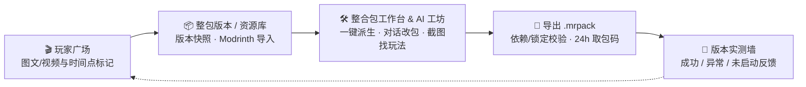
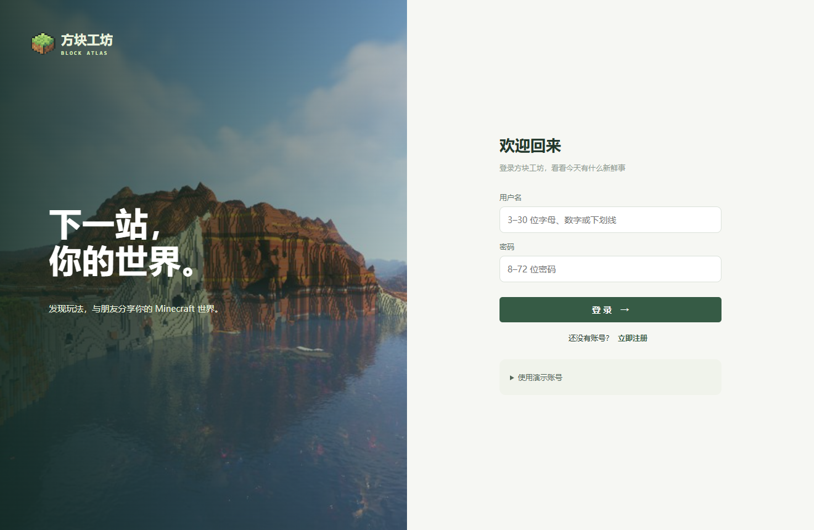
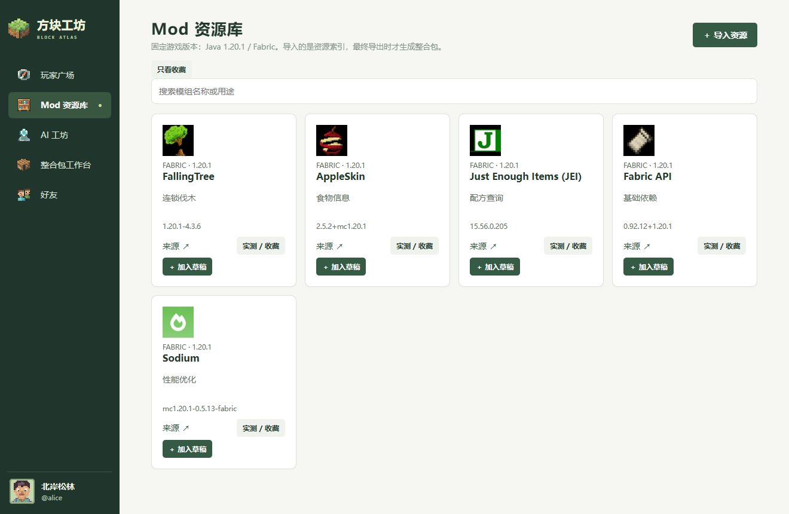
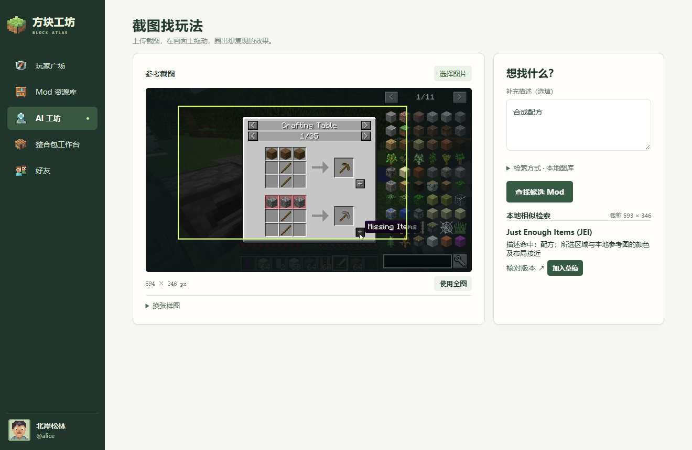
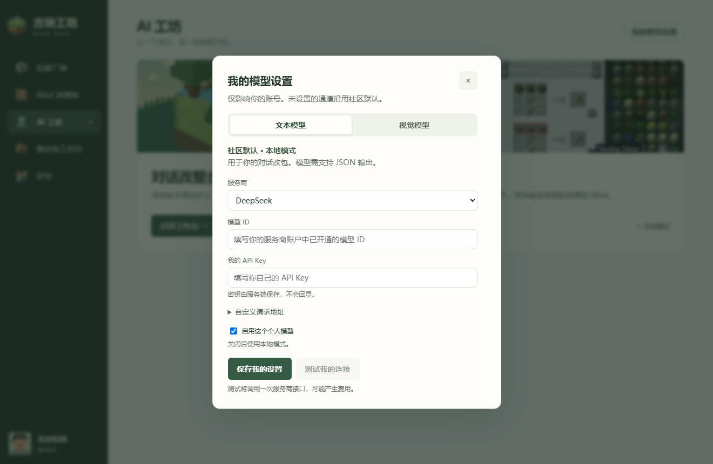
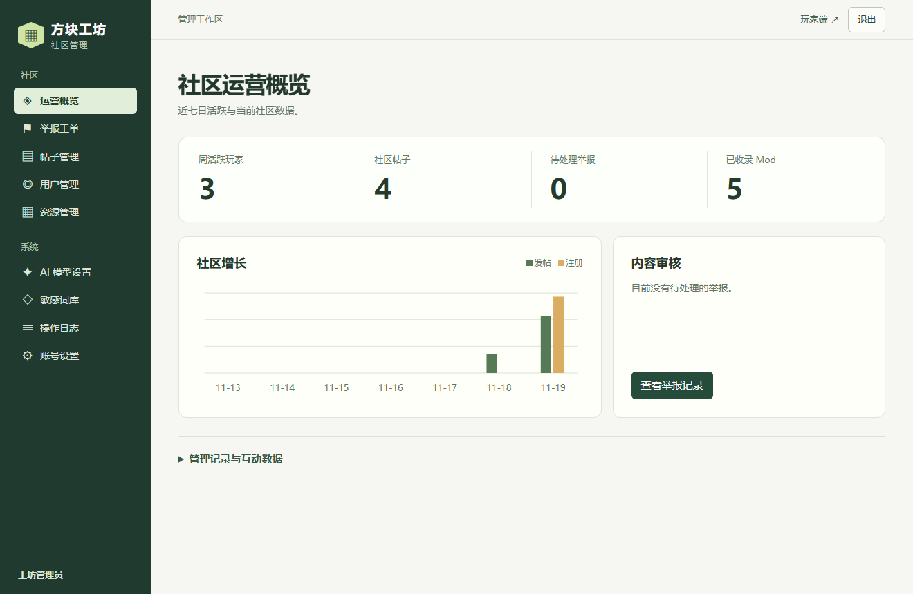
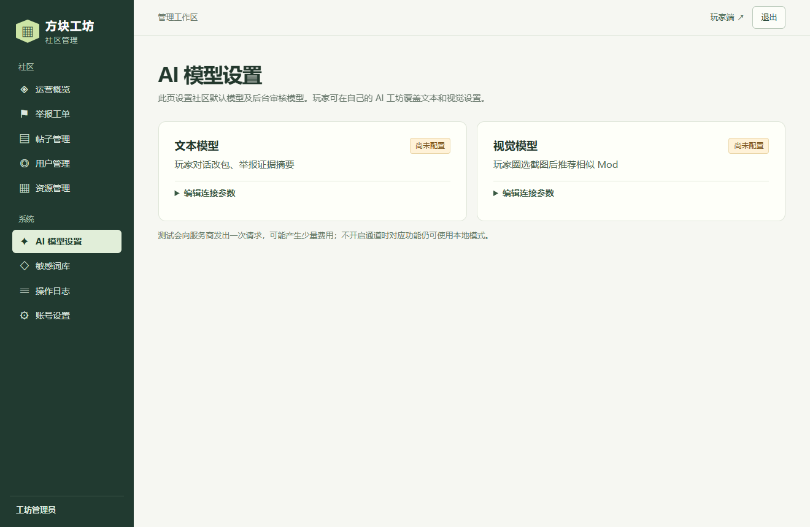
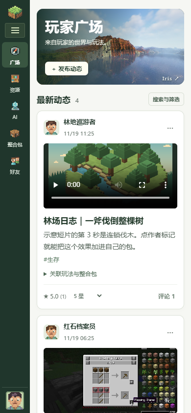
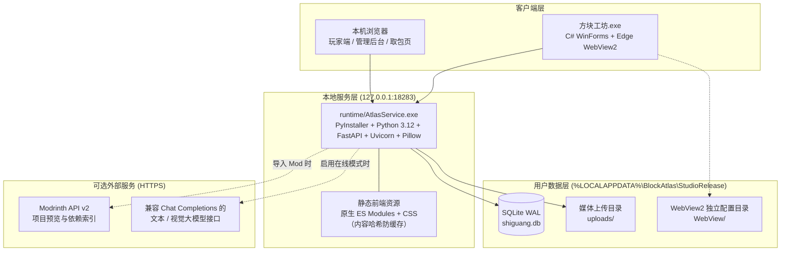

<div align="center">

# 🧱 方块工坊 · Block Atlas

**面向 Minecraft（Java 1.20.1 / Fabric）的桌面端玩法社区、整合包工作台与 AI 改包工坊**

*从一篇实机分享帖出发，把喜欢的玩法直接带进你的 `.mrpack` 整合包*

<p>
  
  
  
  
  
</p>

<p>
  <a href="#-项目简介">项目简介</a> •
  <a href="#-界面预览">界面预览</a> •
  <a href="#-核心特性">核心特性</a> •
  <a href="#-快速开始">快速开始</a> •
  <a href="#-3-分钟完整体验路线">体验路线</a> •
  <a href="#-ai-模型配置">AI 配置</a> •
  <a href="#-技术架构与安全设计">技术架构</a> •
  <a href="#-目录结构与数据存储">目录与数据</a> •
  <a href="#-范围说明与致谢">说明与致谢</a>
</p>

<br />


</div>

---

## 📖 项目简介

**方块工坊（Block Atlas）** 是一款本地优先（Local-First）的 Minecraft 玩家社区与整合包构建桌面应用，致力于打通「**看到喜欢的玩法 → 搞清对应 Mod → 派生修改整合包 → 导出使用 → 反馈实测结果**」的完整链路。

当你刷到一条“一斧伐倒整棵树”的分享帖时，可以直接点击作者标注的视频时间点提取对应 Mod，或一键派生作者当时发布的整份整合包版本，在自己的草稿中通过自然语言指令或截图检索继续调整，最后生成标准 Modrinth `.mrpack` 文件与跨端取包码。



本目录为 **Windows 64 位绿色免安装发行版**，已内置桌面窗口与本地后端运行时，**无需安装 Python 或 Minecraft 即可开箱体验**。

---

## 🖼️ 界面预览

<table>
  <tr>
    <td align="center" width="50%">
      
      <br />
      <sub><b>登录页</b> · 分屏视觉入口与内置演示账号折叠面板</sub>
    </td>
    <td align="center" width="50%">
      
      <br />
      <sub><b>Mod 资源库</b> · 版本锁定清单、收藏筛选与 Modrinth 一键导入</sub>
    </td>
  </tr>
  <tr>
    <td align="center" width="50%">
      
      <br />
      <sub><b>整合包工作台</b> · 草稿来源对比、锁定/撤销保护与 AI 对话改包</sub>
    </td>
    <td align="center" width="50%">
      
      <br />
      <sub><b>AI 工坊</b> · 对话改整合包与截图找玩法双入口及模式状态</sub>
    </td>
  </tr>
  <tr>
    <td align="center" width="50%">
      
      <br />
      <sub><b>截图找玩法</b> · 框选截图局部区域检索相似效果 Mod</sub>
    </td>
    <td align="center" width="50%">
      
      <br />
      <sub><b>个人模型设置</b> · 独立覆盖文本/视觉通道，密钥 DPAPI 加密不回显</sub>
    </td>
  </tr>
  <tr>
    <td align="center" width="50%">
      
      <br />
      <sub><b>独立运营后台</b> · 活跃指标、七日增长柱状图与举报审核入口</sub>
    </td>
    <td align="center" width="50%">
      
      <br />
      <sub><b>社区 AI 配置</b> · 管理员统一管理社区默认与审核辅助模型</sub>
    </td>
  </tr>
</table>

<details>
<summary>📱 展开查看移动端 / 窄屏响应式布局（左侧像素物品栏导航）</summary>
<p align="center">
  <br />
  
</p>
</details>

---

## ✨ 核心特性

### 1. 玩家广场与时间点玩法联动
- 支持发布文字、图片（JPG / PNG / WebP / GIF）与 MP4 视频动态，按关键词、标签与日期（北京时间）组合检索。
- 帖子支持设置 **公开 / 好友可见 / 仅自己可见** 三级权限，并支持 1–5 星评分、嵌套评论回复、敏感词过滤与举报。
- **玩法与整包绑定**：作者可为帖子关联 Mod 与视频秒数标记（点击即可跳至对应片段并加入草稿），也可在发帖时冻结当前草稿生成**不可变整包版本**。
- **社交与玩家行囊**：点击作者头像/昵称直达玩家主页，发起或处理好友申请；左下角头像唤出「玩家行囊」快速管理我的发布、账号设置与登出。

### 2. 整包版本派生（Fork）与实测墙
- 每次随帖发布的整合包都会生成带 SHA-256 摘要的不可变版本快照（无改动不产生重复版本）。
- 任意玩家可查看历史版本清单并点击 **「基于这一版修改」** 派生到个人草稿，实时展示增删差异，完全不影响原帖。
- 每个整包版本拥有独立的实测记录墙（**成功 / 异常 / 未启动**），支持关联自己的公开媒体帖作为实测证据，旧版反馈不混入新版。

### 3. 版本锁定的 Mod 资源库
- 面向 **Minecraft Java 1.20.1 / Fabric**，内置 5 款真实 Modrinth 热门资源并固定版本与 SHA-1 / SHA-512 校验信息。
- 支持粘贴 **Modrinth 项目链接或 slug**（如 `lithium`），实时拉取公共索引预览后导入，自动检查必需前置依赖与冲突声明，不下载也不执行任意 JAR。
- 支持 Mod 收藏、收藏筛选以及按具体版本记录个人实测笔记。

### 4. AI 工坊（离线可用 + 在线模型双模式）
- **对话改整合包**：支持添加、移除、锁定、解锁与多步撤销（最多保留 30 步历史）；自动补齐必需依赖，拦截删除已锁定组件或被其他 Mod 依赖的基础组件，并具备跨端草稿并发冲突检测。
- **截图找玩法**：上传 JPG / PNG / WebP 截图并自由框选局部区域，结合可选描述从资源库中检索可能实现相似效果的候选 Mod 与理由（原始截图不落库）。
- **无 Key 也能演示**：默认本地模式采用中文指令解析与本地参考图库颜色/布局比对；配置在线大模型后无缝切换至在线推理。

### 5. `.mrpack` 快照导出与跨端取包
- 一键生成包含标准 `modrinth.index.json` 的 `.mrpack` 整合包文件，锁定导出瞬间的版本、文件哈希与 Modrinth CDN 下载地址，后续继续修改草稿不影响已导出快照。
- 同步生成 **24 小时有效取包码**，可在电脑端取包页输入取包码直接下载。

### 6. 独立 Web 运营后台
- 提供完全独立的 `/admin` 后台界面与管理员会话，覆盖运营统计概览、举报审核闭环、帖子下架/恢复、用户停用/删除、资源说明维护、敏感词库、AI 社区模型设置与完整操作审计日志。
- 举报审核支持主动生成 **AI 辅助证据摘要**（离线时自动降级为本地证据整理），辅助审核员核对原帖并人工作出保留或下架决定。

---

## 🚀 快速开始

### 运行环境
- **操作系统**：Windows 10 / 11（64 位）
- **运行组件**：Microsoft Edge WebView2 Runtime（Windows 10/11 通常已预装）
- **无需安装**：Python、Node.js 或 Minecraft 客户端

### 启动应用
1. 保持本目录结构完整（请勿移动或删除同级的 `方块工坊.exe.config` 与 `runtime/` 目录）。
2. 双击运行 **`方块工坊.exe`**。
3. 程序会自动在后台拉起本地服务 `runtime\AtlasService.exe`（监听 `127.0.0.1:18283`），连接就绪后自动打开桌面玩家窗口。

> [!TIP]
> 首次启动会自动初始化示例玩家、演示帖子、内置资源库与好友关系；再次启动会保留已有数据，不会重置。

### 本机访问入口

启动 `方块工坊.exe` 后，除桌面客户端窗口外，也可以在同一台电脑的浏览器中访问以下入口（共用同一份本地数据库）：

| 入口 | 地址 | 用途说明 |
| --- | --- | --- |
| **玩家社区** | `http://127.0.0.1:18283/` | 与桌面窗口完全一致的玩家社区、资源库、AI 工坊与工作台 |
| **Web 管理后台** | `http://127.0.0.1:18283/admin` | 独立管理员登录，负责审核举报、管理用户/帖子/词库与社区 AI 配置 |
| **电脑取包页** | `http://127.0.0.1:18283/pickup` | 输入工作台生成的 24 小时取包码，直接下载 `.mrpack` 文件 |

### 内置演示账号

登录页点击「使用演示账号」可快速查看，亦可自行注册新账号：

| 角色 | 昵称 | 用户名 | 初始密码 |
| --- | --- | --- | --- |
| 玩家 | 北岸松林 | `alice` | `Alice123!` |
| 玩家 | 林地巡游者 | `bob` | `Bob12345!` |
| 玩家 | 红石档案员 | `carol` | `Carol123!` |
| 管理员 | 工坊管理员 | `admin` | `Admin123!` |

> [!NOTE]
> 如需演示修改密码、停用/删除用户等破坏性操作，建议先注册一个新的测试账号，保留上述演示账号方便重复展示。

---

## 🎯 3 分钟完整体验路线

1. **浏览玩法与时间点标记**
   用 `alice` 登录，在「玩家广场」打开《林场日志｜一斧伐倒整棵树》。展开 **「关联玩法与整合包」**，点击作者标记可跳转至视频第 3 秒。
2. **基于作者版本派生整合包**
   点击 **「查看整包与实测 → 基于这一版修改」**，进入「整合包工作台」。顶部会标明草稿来源，后续增删只作用于自己的草稿，不会改动原帖。
3. **对话改包与规则保护**
   在工作台输入：`加上配方查询，锁定性能优化`，观察 `JEI` 自动入包且 `Sodium` 被锁定。再尝试输入 `移除性能优化` 或 `移除基础依赖`，系统会拦截并说明锁定/依赖原因；点击 **「撤销」** 可回退上一步。
4. **截图找玩法 & Modrinth 导入**
   - 在「AI 工坊 → 截图找玩法」中上传任意截图（或直接使用内置样图）框选区域检索候选 Mod。
   - 在「Mod 资源库」输入 Modrinth 标识（如 `lithium`），预览 1.20.1 / Fabric 正式版信息后确认入库。
5. **导出 `.mrpack` 与取包码**
   回到工作台点击 **「生成最终包」** 直接下载 `.mrpack`，或复制取包码在 `http://127.0.0.1:18283/pickup` 验证下载。
6. **独立后台审核闭环**
   在浏览器打开 `http://127.0.0.1:18283/admin` 并使用 `admin` 登录，查看运营统计、用户与帖子管理；可先用普通玩家举报测试帖，再于后台生成证据摘要并执行保留或下架。

---

## 📚 内置 Mod 资源目录

预置目录对应 **Minecraft Java 1.20.1** 与 **Fabric Loader 0.19.4**，支持通过 Modrinth 在线扩充：

| Slug | Mod 名称 | 锁定版本 | 必需依赖 | 核心作用 |
| --- | --- | --- | --- | --- |
| `fabric-api` | Fabric API | `0.92.12+1.20.1` | — | Fabric 生态通用前置与基础钩子库 |
| `sodium` | Sodium | `mc1.20.1-0.5.13-fabric` | — | 高性能渲染引擎，大幅提升帧率、减少卡顿 |
| `jei` | Just Enough Items (JEI) | `15.56.0.205` | `fabric-api` | 物品清单与合成配方查询 |
| `fallingtree` | FallingTree | `1.20.1-4.3.6` | `fabric-api` | 砍伐一格木头即可连锁伐倒整棵树 |
| `appleskin` | AppleSkin | `2.5.2+mc1.20.1` | `fabric-api` | 饥饿值、饱食度与食物恢复量 HUD 增强 |

---

## 🤖 AI 模型配置

**无需任何 API Key 即可完整体验本地模式。** 如需启用在线大模型推理，支持在界面中按需配置，保存即刻生效、无需重启。

### 两级配置优先级

| 级别 | 入口位置 | 作用范围 |
| --- | --- | --- |
| **个人配置**（优先） | 玩家端「AI 工坊」(`/#ai`) → **我的模型设置** | 仅对当前登录玩家生效，可为文本、视觉通道分别设置；恢复默认后重新跟随社区配置 |
| **社区默认**（管理员） | 运营后台「AI 模型设置」(`/admin#ai`) | 作为未配置个人模型的玩家的默认通道，同时供后台举报审核摘要使用 |

### 支持的服务商与要求
- **内置预设服务商**：DeepSeek（`api.deepseek.com`）、阿里云百炼 DashScope（`dashscope.aliyuncs.com`）、OpenAI（`api.openai.com`）以及受支持的阿里云百炼区域 MaaS HTTPS 端点。
- **能力要求**：
  - **文本通道**：需兼容 Chat Completions 且支持 JSON 输出（`response_format: json_object`）。
  - **视觉通道**：需支持多模态 `image_url` 图片输入；配置后玩家仍需在「截图找玩法」主动勾选在线识图，后端仅发送重新编码的裁剪区域。
- **连接测试与密钥保护**：
  - 保存配置本身不产生外部请求；点击 **「测试连接」** 才会发起一次探针调用（文本校验 JSON 解析，视觉使用程序生成的纯红小图验证识色，不上传私人图片）。
  - Windows 下 API Key 使用当前系统用户的 **DPAPI（`CryptProtectData`）** 加密保存，绝不回显明文给前端，也不会随程序目录泄露。

---

## 🏗️ 技术架构与安全设计

### 运行架构



### 技术栈一览

| 层级 | 技术选型 |
| --- | --- |
| 桌面宿主 | C# (.NET WinForms) + Microsoft Edge WebView2 SDK |
| 后端服务 | Python 3.12 + FastAPI + Uvicorn + Pydantic + Pillow（PyInstaller 独立打包） |
| 数据存储 | SQLite（WAL 日志模式 + 强制外键约束 + 参数化 SQL）+ 本地媒体文件存储 |
| 前端界面 | 原生 HTML5 / CSS3 / ES Modules（零外部 CDN 依赖，响应桌面/平板/手机宽度） |

### 核心安全机制
- **密码与会话**：随机盐 + 260,000 轮 `PBKDF2-HMAC-SHA256` 密码存储；会话表仅保存令牌 SHA-256 摘要，有效期 7 天；Web 端采用 `HttpOnly` + `SameSite=Strict` Cookie；修改密码或停用账号立即撤销该用户全部会话。
- **接口与内容防护**：登录接口按来源 IP 限流（每分钟最多 20 次）；所有接口设置 `X-Content-Type-Options: nosniff`、`Referrer-Policy: same-origin`、`Cache-Control: no-store`；私密媒体必须经过服务端动态权限校验后输出，不通过静态目录裸露。
- **上传与密钥安全**：上传媒体校验字节上限（单文件 ≤ 50 MB，截图检索 ≤ 8 MB）、MP4 `ftyp` 签名与 Pillow 像素解码校验；AI 密钥仅在服务端通过 Windows DPAPI 加密持久化，且接口地址经 HTTPS 白名单与禁止重定向校验。

---

## 📁 目录结构与数据存储

### 发行版目录结构

```text
D:\方块工坊\
├── 方块工坊.exe                 # Windows 桌面客户端入口（WinForms + WebView2 宿主）
├── 方块工坊.exe.config          # .NET 程序集加载配置（指向 runtime/）
├── README.md                    # 项目说明文档
├── docs/
│   └── screenshots/             # README 展示用界面截图
└── runtime/                     # 内置本地服务与 WebView2 运行时（请勿删除或拆分）
    ├── AtlasService.exe         # 独立打包的 FastAPI 本地服务进程
    ├── WebView2Loader.dll       # WebView2 加载器与托管封装库
    ├── Microsoft.Web.WebView2.*.dll
    ├── LICENSE.txt              # WebView2 组件许可说明
    ├── ThirdPartyNotices.txt    # 第三方开源组件声明
    └── _internal/               # Python 运行时、依赖库及内置前端/演示素材
```

### 程序与数据分离

本发行版将程序文件与用户业务数据完全解耦，直接复制本文件夹到其他电脑 **不会带走本机账号、帖子或模型 API Key**：

| 数据类型 | 本地存储路径 |
| --- | --- |
| 数据库（`shiguang.db`）、上传媒体（`uploads/`）与 DPAPI 加密密钥 | `%LOCALAPPDATA%\BlockAtlas\StudioRelease\data` |
| 桌面窗口 WebView2 缓存与登录态 | `%LOCALAPPDATA%\BlockAtlas\StudioRelease\WebView` |

- **备份数据**：关闭程序及后台 `AtlasService.exe` 后，完整备份上述 `data` 目录即可。
- **重置演示数据**：退出程序并结束 `AtlasService.exe` 后，删除或重命名上述 `data` 目录，再次双击 `方块工坊.exe` 即可重新生成干净的演示环境。

---

## ℹ️ 范围说明与致谢

### 使用范围与已知边界
- **关于 `.mrpack` 导出**：生成的 `.mrpack` 包含 `modrinth.index.json` 元数据、文件校验哈希与官方 CDN 下载链接，不包含 Mod JAR 本体；在支持 Modrinth 格式的启动器（如 Modrinth App、Prism Launcher、HMCL、PCL2 等）首次导入安装时需保持联网，推荐使用独立的 Minecraft Java 1.20.1 + Java 17 实例。
- **关于兼容性校验**：导入与工作台依赖检查基于 Modrinth 固定版本声明的必需前置与冲突字段，**生成整合包不等于已完成进游戏实机启动测试**；不支持 CurseForge 抓取或自动更新订阅。
- **关于演示素材**：示例帖中的伐木短片为原创像素动画示意，并非 Minecraft 实机录屏；截图找玩法输出的是库内候选 Mod 与推理依据，不代表识别出原截图实际安装的组件。
- **关于发行包内容**：本目录仅包含 Windows x64 桌面运行程序及运行依赖，不包含开发源码、微信小程序工程及测试脚本。

### 素材归属与第三方声明
- 内置资源图标与示例场景图来源于 Modrinth 公开项目图库：[Sodium](https://modrinth.com/mod/sodium)、[Just Enough Items (JEI)](https://modrinth.com/mod/jei)、[FallingTree](https://modrinth.com/mod/fallingtree)、[AppleSkin](https://modrinth.com/mod/appleskin)、[Fabric API](https://modrinth.com/mod/fabric-api) 及 [Iris](https://modrinth.com/mod/iris)。公开再分发前请核对各上游项目授权条款。
- 内置第三方运行库及 WebView2 组件许可详见 `runtime/LICENSE.txt` 与 `runtime/ThirdPartyNotices.txt`。
